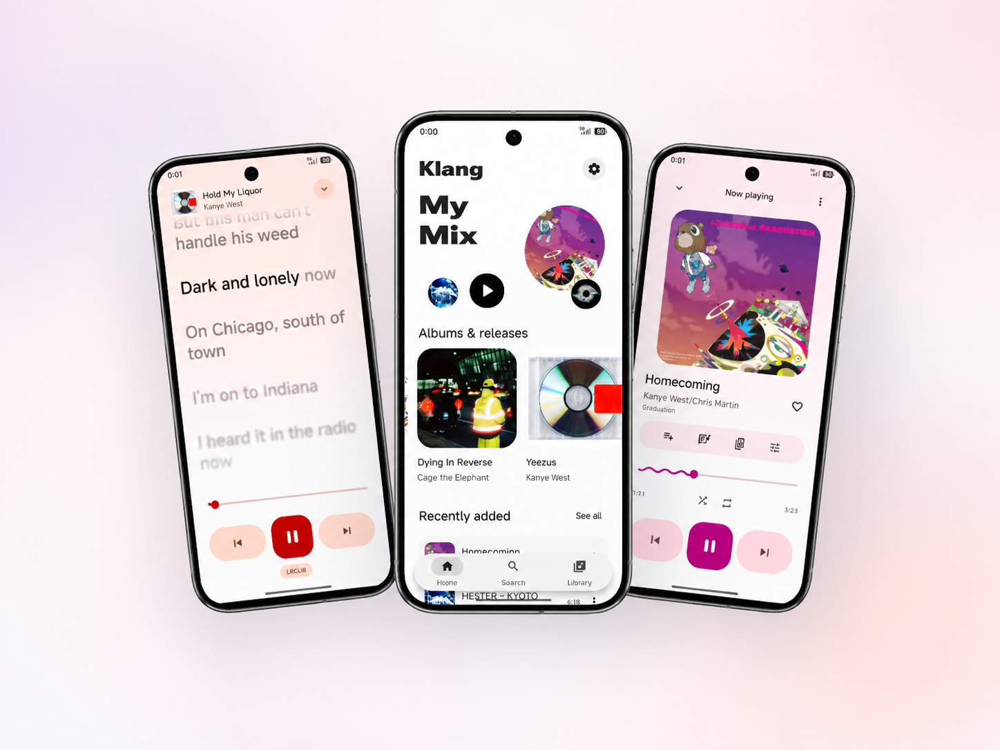
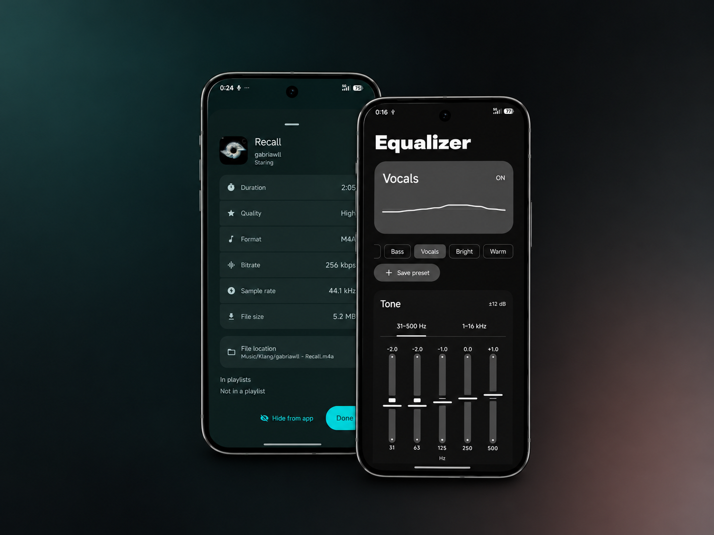

# Klang

<div align="center">

[](https://github.com/lynlioss/klang/stargazers)
[](https://github.com/lynlioss/klang/blob/main/LICENSE)
[](https://github.com/lynlioss/klang/releases/latest)
[](https://github.com/lynlioss/klang/releases)

</div>

A lightweight music player for Android, built with Material 3 Expressive.

*Klang* is the German word for "sound" or "tone". It covers the note itself and the way it carries across a room.

> Beta. Klang is unstable and in active development, so some features are not ready yet and things move around between releases.

## Features

- Play local music with artwork and track details read from your files.
- My Mix shuffles your whole library automatically. Delete audio files from Properties with confirmation.
- Import public Spotify and YouTube Music songs and playlists, with background progress, embedded artwork and original audio quality.
- Create and manage playlists, and arrange the songs in any order.
- Adjust the sound with a 10-band EQ, custom presets and separate speaker and Bluetooth settings.
- Connect to other services through plugins.
- Follow synced lyrics, with word-by-word highlighting when available.
- Browse your library and control playback through a Material 3 Expressive interface.
- Analytics are optional and off until you choose Yes. Change your choice in Settings → Privacy.



## Get it

Grab the latest build from the [releases page](https://github.com/lynlioss/klang/releases/latest).

Read the [music import guide](docs/music-imports.md) for source support and quality details.

To create a lyrics or music download provider, read the [plugin guide](docs/plugins.md). Plugins install from GitHub releases and can define their own settings and links. The optional [Music Import plugin](https://github.com/lynlioss/music-import-klang) keeps download runtimes outside Klang and supports songs, albums, EPs and playlists.

## Build it yourself

You need JDK 17 and the Android SDK with platform 37.2 and build tools 37.

```sh
git clone https://github.com/lynlioss/klang.git
cd klang
printf 'sdk.dir=/path/to/Android/sdk\n' > local.properties
./gradlew assembleDebug
```

The APK lands in `app/build/outputs/apk/debug/app-debug.apk`. A release build runs `./gradlew assembleRelease` and is signed with the key named in `keystore.properties`, or with the debug key when no keystore is configured.

For optional analytics, copy [.env.example](.env.example) to `.env` at the repository root and set your PostHog project token. Builds without a token work normally and cannot send analytics. See the [analytics guide](docs/analytics.md) for consent, event definitions and daily or weekly reporting.

Klang is released under the GNU GPL v3. The licenses for the bundled fonts and icons are in `licenses/`.
